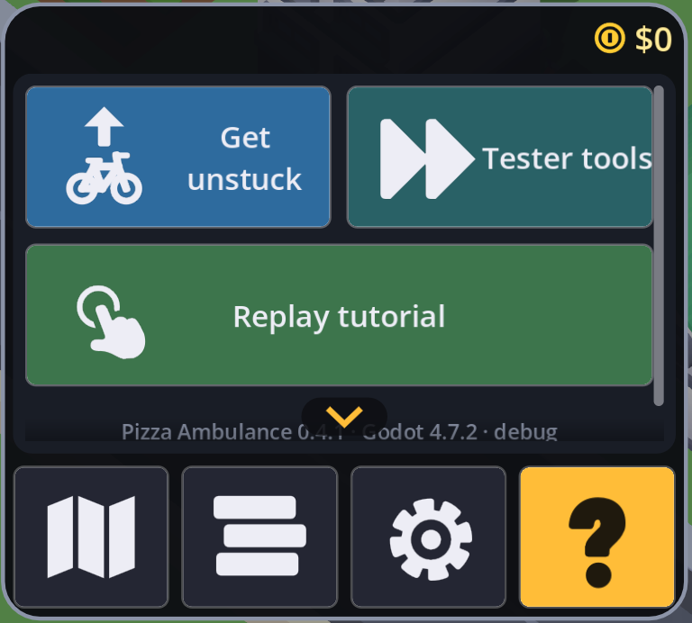
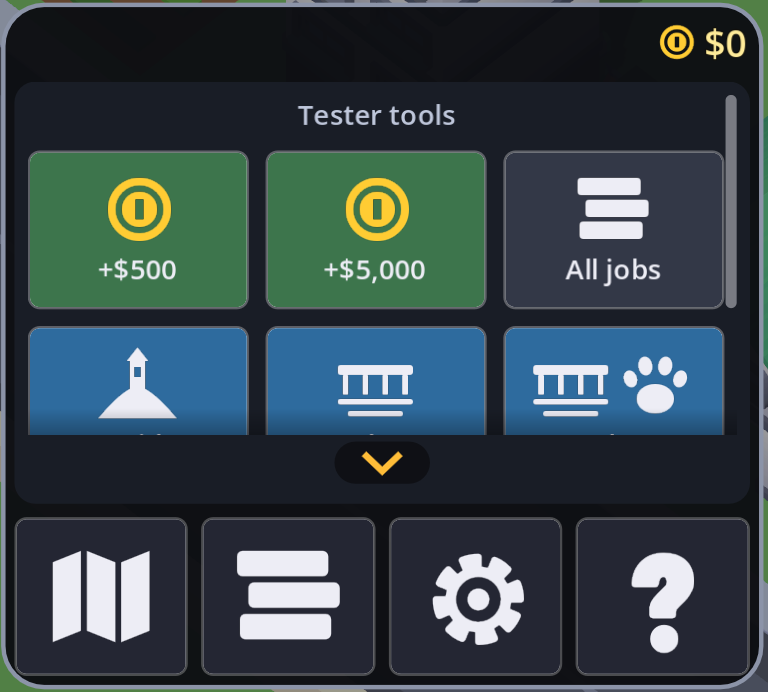

0.4.1 is a small update to 0.4.0. The camera is closer, two new companions join the kennel, and the game opens with the studio's own logo. Testers also get a few tools for skipping the parts they've already played.

## New

- **A new start:** the game opens with the Bryo Studio logo, a tuft of moss growing on a stone, instead of Godot's. Once the game has loaded, a small skip arrow appears in the corner; tap anywhere to skip.
- **Two new companions:** a rhino beetle and a Komodo dragon, $350 each at the kennel. They fetch slices like the others.
- **Tester tools,** in Help > Tester tools. Add money, open every job, start again from a ready-made save (the Harbour, with or without a dog, or everything owned), or start a fresh save. Your old save is kept on the phone. How to use them is [below](#using-the-tester-tools).

## Changed

- **The camera is closer** (13 m instead of 16 m), so the bike, the stack and the street are bigger on screen.
- **Companions are bigger** while they run beside you, and shrink when they hop on the bike.
- **Kennel prices:**
  - The dog, cat and parrot are $150 each. The penguin is $600, the fox $1,000 and the panda $4,000.
  - The upgrades cost more: the pouch is $1,500, the 2nd pouch $1,800, the harness $2,000, the collar $2,200 and the gold cape $2,400.
  - Anything you already bought stays yours.

## Fixed

- The kennel sold upgrades before you owned a companion to use them. The first upgrade now waits, with a padlock, until you have one.

## Using the tester tools

They're for skipping what you've already played, so you can get straight to whatever's new in an update.

1. Tap the phone button in the top-right corner to open the phone.
2. Tap **?** (Help), the last button along the bottom.
3. Tap **Tester tools**, beside Get unstuck.

Each tile does one thing:

- **+$500** and **+$5,000** add money straight away.
- **All jobs** opens every job on the board.
- **Mid**, **Harbour**, **+ dog** and **All** load a ready-made save: partway through Hillside; the Harbour open with no companion yet; the same with the dog; or everything owned. Scroll down for the last ones.
- **New save** starts again from the very beginning.

The tiles that replace your save turn amber and ask **Sure?** first; tap again to go ahead. Your old save isn't deleted. It's kept on the phone, in case you want it back (write to us). The save tiles and All jobs wait until you've finished or given up the job you're on. Money works any time.

When you use a tool, the game notes which one, so we know the rest of that session's play was helped along. That's only sent while Share play data is on ([privacy](/privacy/pizza-ambulance/)).

Found something odd? Write to [hello@bryostudio.com](mailto:hello@bryostudio.com) and say which version you're on.
